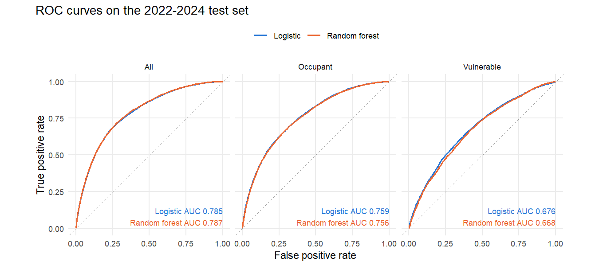
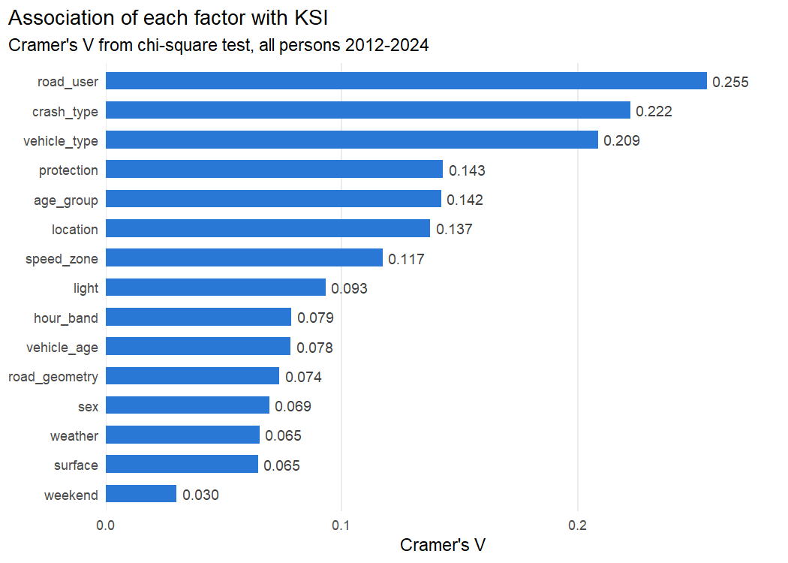
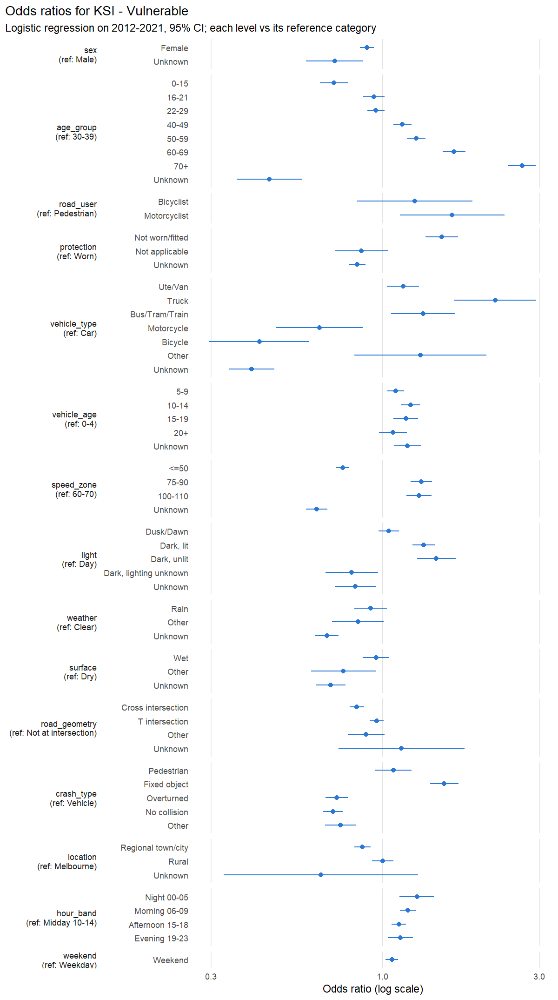

# Victorian Road Crash Severity Analysis


Person-level modelling of crash injury severity on 12+ years of Victorian (Australia) road crash records.
Nine relational tables are joined into a single 425,352-row analytical dataset, profiled with
effect-size-ranked EDA, and used to compare interpretable logistic regression against random forests
on a strict out-of-time test set.

**Target:** `KSI` - person killed or seriously injured (`INJ_LEVEL` 1 or 2), 18.6% prevalence.

## Highlights

- **ETL across 9 tables** with documented handling of duplicate node rows, multi-record weather/surface
  conditions, and 17k pedestrians with no vehicle id (re-linked to the striking vehicle via `accident_event`).
  Every step's record count is logged to `output/cleaning_log.csv`.
- **Leakage control:** post-crash fields (`SEVERITY`, `TAKEN_HOSPITAL`, `EJECTED_CODE`, `LEVEL_OF_DAMAGE`,
  `NO_PERSONS_*`) excluded from features.
- **Out-of-time validation:** train 2012-2021, test 2022-2024 (KSI rate drifts 19.3% to 16.1%).
- **Two modelling pipelines** for robustness:
  - **A** - 15 factors, class-balanced training, LR vs RF (`ranger`, 300 trees), DeLong test on AUC.
  - **B** - 9 factors, crash-clustered standard errors, fit/validation/test split, tuned threshold and RF grid,
    calibration analysis, interaction model with joint Wald test.
- **Subgroup models** for occupants vs vulnerable road users (pedestrians, cyclists, motorcyclists).

## Results

Test set 2022-2024 (96,870 people), Pipeline A:

| Group | n (test) | LR AUC | RF AUC | DeLong p (two-sided) |
|---|---:|---:|---:|---:|
| All | 96,870 | 0.785 | 0.787 | 0.020 |
| Occupant | 80,820 | 0.759 | 0.756 | 0.047 |
| Vulnerable | 13,574 | 0.676 | 0.668 | 0.008 |

Pipeline B (unbalanced, tuned threshold): LR AUC 0.754, tuned RF AUC 0.759, Brier 0.118 / 0.117.

**Takeaways**

1. Random forest adds no practically meaningful discrimination over logistic regression, which stays fully
   interpretable through odds ratios.
2. Strongest factors by Cramer's V: road-user type (0.255), crash type (0.222), vehicle type (0.209).
3. Occupant severity is driven by crash type, age, speed zone and location. Vulnerable road-user severity is
   driven by the striking vehicle (truck OR ~2.3 vs car), age 70+ (OR ~2.6), vehicle age and speed zone.
4. Pedestrians and cyclists hit by trucks are KSI ~69% of the time vs ~46% when hit by cars.

<p align="center">
  
</p>
<p align="center">
  
  
</p>

## Repository structure

```
.
├── 01_load_join.R                    # join 9 tables -> one row per person
├── 02_clean_features.R               # recode unknowns, build 15 factor features, time split
├── 03_eda.R                          # KSI rates, chi-square, Cramer's V, charts
├── 04_models.R                       # LR vs RF per group, odds ratios, DeLong test
├── crash_analysis.R                  # Pipeline A (01-04) as a single script
├── crash_analysis_both_pipelines.R   # Pipeline A + Pipeline B end to end
└── output/
    ├── cleaning_log.csv, feature_log.csv
    ├── eda/          # rate tables, chi-square results, charts
    ├── models/       # metrics, AUC tests, odds ratios, ROC, importance
    ├── pipeline_b/   # clustered ORs, test metrics, calibration, sensitivity
    └── console/      # captured script output
```

## Getting started

**Requirements:** R 4.x

```r
install.packages(c("data.table", "ggplot2", "ranger", "pROC", "caret"))
```

**Data** (not tracked, ~170 MB): download the CSVs from
[Victoria Road Crash Data](https://opendata.transport.vic.gov.au/dataset/victoria-road-crash-data)
into `data/`:

```
accident.csv  accident_event.csv  accident_location.csv  atmospheric_cond.csv  node.csv
person.csv    road_surface_cond.csv  sub_dca.csv  vehicle.csv
```

**Run** from the repository root:

```bash
# step by step
Rscript 01_load_join.R
Rscript 02_clean_features.R
Rscript 03_eda.R
Rscript 04_models.R          # ~5 min

# or everything in one go (~8 min; set TUNE <- TRUE to rerun the Pipeline B grid search)
Rscript crash_analysis_both_pipelines.R
```

Seeds are fixed (`set.seed(42)`), so outputs in `output/` are reproducible.

## Limitations

- 2024 is a partial year (data ends 30 Sep 2024).
- Helmet/seatbelt status is unknown for ~115k people and may itself correlate with severity.
- With n > 400k every chi-square test is significant, so factors are ranked by effect size, not p-value.
- Balanced training inflates predicted probabilities (mean 0.42 vs observed 0.16); Pipeline A models are
  used for ranking, Pipeline B for calibrated probabilities.

## Data source

Victoria Road Crash Data, Department of Transport and Planning, via
[Transport Victoria Open Data](https://opendata.transport.vic.gov.au/dataset/victoria-road-crash-data).
